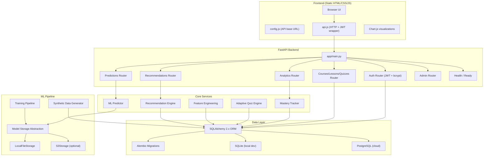

# SkillSync LMS — Architecture & Design Document

## 1. Overview

SkillSync LMS is an **Adaptive Learning Platform** that personalizes education through learning analytics, student performance prediction, and intelligent recommendations. It is designed to run locally with a single command and be deployable to any cloud provider with configuration changes only.

---

## 2. Architecture Diagram



---

## 3. Folder Structure

```
skillsync-lms/                     (project root = d:\SkillSync LMS)
├── app/
│   ├── __init__.py
│   ├── main.py                    # FastAPI app entry point, mounts static files
│   ├── config.py                  # pydantic-settings: all env vars
│   ├── database.py                # SQLAlchemy engine, session, Base
│   ├── logging_config.py          # Structured JSON logging
│   ├── security.py                # JWT creation/verification, password hashing
│   ├── models/
│   │   ├── __init__.py
│   │   ├── user.py
│   │   ├── course.py
│   │   ├── quiz.py
│   │   ├── progress.py
│   │   └── prediction.py
│   ├── schemas/
│   │   ├── __init__.py
│   │   ├── user.py
│   │   ├── course.py
│   │   ├── quiz.py
│   │   ├── progress.py
│   │   └── prediction.py
│   ├── routers/
│   │   ├── __init__.py
│   │   ├── auth.py
│   │   ├── courses.py
│   │   ├── lessons.py
│   │   ├── quizzes.py
│   │   ├── questions.py
│   │   ├── progress.py
│   │   ├── analytics.py
│   │   ├── predictions.py
│   │   ├── recommendations.py
│   │   └── admin.py
│   └── services/
│       ├── __init__.py
│       ├── mastery.py             # Topic mastery tracking + decay
│       ├── adaptive.py            # Adaptive difficulty selection
│       ├── analytics.py           # Analytics aggregation
│       └── user_service.py
├── alembic/
│   ├── env.py
│   ├── script.py.mako
│   └── versions/
├── alembic.ini
├── ml/
│   ├── __init__.py
│   ├── features.py               # Feature engineering per student/course
│   ├── train.py                   # Model training script
│   ├── predict.py                 # Load model, run predictions
│   ├── storage.py                 # LocalFileStorage + S3Storage abstraction
│   └── artifacts/                 # Default local model storage
├── recommender/
│   ├── __init__.py
│   └── engine.py                  # Hybrid rule-based + collaborative engine
├── scripts/
│   ├── generate_data.py           # Synthetic data generator (~150 students)
│   └── seed.py                    # Seed DB with generated data + demo accounts
├── frontend/
│   ├── index.html                 # Login / landing page
│   ├── css/
│   │   └── style.css              # CSS variables, light/dark mode, responsive
│   ├── js/
│   │   ├── config.js              # API_BASE_URL (single source of truth)
│   │   ├── api.js                 # Fetch wrapper: JWT, 401 handling
│   │   ├── auth.js
│   │   ├── router.js              # Client-side SPA routing
│   │   ├── charts.js              # Chart.js helpers
│   │   └── utils.js
│   └── pages/
│       ├── dashboard-student.html
│       ├── dashboard-teacher.html
│       ├── dashboard-admin.html
│       ├── course.html
│       ├── lesson.html
│       ├── quiz.html
│       ├── register.html
│       └── ...
├── tests/
│   ├── conftest.py                # Fixtures: temp SQLite DB, TestClient, auth helpers
│   ├── test_auth.py
│   ├── test_courses.py
│   ├── test_quiz.py
│   ├── test_mastery.py
│   ├── test_adaptive.py
│   ├── test_predictions.py
│   ├── test_recommendations.py
│   ├── test_health.py
│   └── test_permissions.py
├── docs/
│   ├── DESIGN.md                  # This file
│   ├── API.md
│   └── DEPLOYMENT.md
├── Dockerfile
├── docker-compose.yml
├── Procfile
├── vercel.json
├── requirements.txt
├── .env.example
├── .dockerignore
├── .gitignore
└── README.md
```

---

## 4. Data Model (ERD)

```mermaid
erDiagram
    users {
        int id PK
        string name
        string email UK
        string password_hash
        string role "student | teacher | admin"
        datetime created_at
    }

    courses {
        int id PK
        string title
        string description
        int teacher_id FK
    }

    modules {
        int id PK
        int course_id FK
        string title
        int order
    }

    lessons {
        int id PK
        int module_id FK
        string title
        text content
        string topic
        int est_minutes
        int order
    }

    questions {
        int id PK
        int course_id FK
        string topic
        string difficulty "easy | medium | hard"
        text text
        json options_json
        int correct_index
    }

    quizzes {
        int id PK
        int course_id FK
        int module_id FK
        string title
    }

    quiz_questions {
        int quiz_id FK
        int question_id FK
    }

    enrollments {
        int id PK
        int student_id FK
        int course_id FK
        datetime enrolled_at
    }

    quiz_attempts {
        int id PK
        int student_id FK
        int quiz_id FK
        float score
        float max_score
        int duration_sec
        datetime started_at
        datetime finished_at
    }

    attempt_answers {
        int id PK
        int attempt_id FK
        int question_id FK
        int selected_index
        boolean is_correct
        int time_taken_sec
    }

    lesson_progress {
        int id PK
        int student_id FK
        int lesson_id FK
        boolean completed
        int time_spent_sec
        datetime last_visited
    }

    topic_mastery {
        int student_id FK
        int course_id FK
        string topic
        float mastery "0.0 to 1.0"
        datetime updated_at
    }

    predictions {
        int id PK
        int student_id FK
        int course_id FK
        float predicted_score
        string risk_level "Low | Medium | High"
        json top_factors_json
        datetime created_at
    }

    recommendations {
        int id PK
        int student_id FK
        int course_id FK
        string type "lesson | quiz | action"
        int target_id
        string reason
        int priority
        datetime created_at
    }

    users ||--o{ courses : "teaches"
    users ||--o{ enrollments : "enrolls"
    courses ||--o{ modules : "has"
    modules ||--o{ lessons : "has"
    courses ||--o{ questions : "has"
    courses ||--o{ quizzes : "has"
    modules ||--o{ quizzes : "has"
    quizzes ||--o{ quiz_questions : "includes"
    questions ||--o{ quiz_questions : "included_in"
    users ||--o{ quiz_attempts : "takes"
    quizzes ||--o{ quiz_attempts : "attempted"
    quiz_attempts ||--o{ attempt_answers : "has"
    questions ||--o{ attempt_answers : "answered"
    users ||--o{ lesson_progress : "tracks"
    lessons ||--o{ lesson_progress : "tracked"
    users ||--o{ topic_mastery : "has"
    courses ||--o{ topic_mastery : "in"
    users ||--o{ predictions : "predicted"
    courses ||--o{ predictions : "for"
    users ||--o{ recommendations : "receives"
    courses ||--o{ recommendations : "in"
```



---

## 5. Adaptive Learning Algorithm

### 5.1 Mastery Update Formula

After a student answers a question, topic mastery is updated using an **exponentially weighted moving average** that accounts for question difficulty:

$$M_{new} = M_{old} + \alpha \cdot w_d \cdot (outcome - M_{old})$$

Where:
- $M_{old}$ = current mastery (0.0–1.0)
- $outcome$ = 1.0 if correct, 0.0 if incorrect
- $\alpha$ = learning rate = 0.15
- $w_d$ = difficulty weight:
  - **Easy**: correct → 0.6, incorrect → 1.4 (wrong on easy hurts more)
  - **Medium**: correct → 1.0, incorrect → 1.0 (neutral)
  - **Hard**: correct → 1.4, incorrect → 0.6 (right on hard helps more)

This means:
- Getting a **hard** question right boosts mastery significantly
- Getting an **easy** question wrong drops mastery significantly
- Medium questions have balanced weight

### 5.2 Adaptive Difficulty Selection

When selecting the next question in a quiz:

| Current Mastery | Recommended Difficulty |
|---|---|
| < 0.4 | Easy |
| 0.4 – 0.7 | Medium |
| > 0.7 | Hard |

The engine avoids repeating already-answered questions in the current attempt.

### 5.3 Forgetting Decay

Topics not practiced for 7+ days undergo a daily decay:

$$M_{decayed} = M_{current} \cdot (0.95)^{days\_inactive - 7}$$

This is applied lazily when mastery is read, not on a cron job.

---

## 6. ML Pipeline

### 6.1 Features (per student per course)

| Feature | Description |
|---|---|
| avg_quiz_score | Mean of (score / max_score) across attempts |
| score_trend | Linear regression slope of scores over time |
| avg_mastery | Mean of all topic masteries |
| weakest_mastery | Minimum topic mastery |
| lessons_completion_pct | Completed lessons / total lessons |
| total_time_spent | Sum of quiz duration + lesson time |
| days_active_14 | Count of distinct active days in last 14 |
| avg_time_per_question | Mean time per answered question |
| attempt_count | Total number of quiz attempts |
| days_since_last_activity | Days since the most recent action |

### 6.2 Model

- **Regression**: `GradientBoostingRegressor` → predicted final score (0–100)
- **Risk level**: derived from predicted score:
  - ≥ 70 → Low risk
  - 50–70 → Medium risk
  - < 50 → High risk
- **Explanation**: Feature importances → top 3 factors translated to plain English

### 6.3 Model Storage Abstraction

```python
class ModelStorage(ABC):
    def save(self, model, path: str) -> None: ...
    def load(self, path: str) -> Any: ...
    def exists(self, path: str) -> bool: ...

class LocalFileStorage(ModelStorage): ...   # joblib to local disk
class S3Storage(ModelStorage): ...          # boto3 to S3 bucket
```

Selected via `MODEL_STORAGE` env var (`local` or `s3`).

---

## 7. Recommendation Engine

### 7.1 Rule-Based Rules

| Condition | Recommendation |
|---|---|
| Topic mastery < 0.5 | Lessons + easy/medium quizzes in that topic |
| Topic mastery > 0.8 | Harder quizzes to challenge |
| Inactive ≥ 5 days | Re-engagement nudge |
| High risk prediction | Prioritized remediation plan |

### 7.2 Collaborative Filtering

1. Build mastery vectors for all students in a course
2. Compute cosine similarity between target student and others
3. Find top-5 similar students who improved in weak topics
4. Recommend lessons/quizzes that helped those students
5. Deduplicate with rule-based recommendations

### 7.3 Output

Each recommendation includes:
- `type`: lesson / quiz / action
- `target_id`: the specific lesson or quiz
- `reason`: human-readable, e.g. "Your Algebra mastery is 38%. Similar students improved after completing 'Algebra Basics' lesson."
- `priority`: 1 (highest) to 10 (lowest)

---

## 8. Deployment Strategy

### 8.1 Local Development

```bash
# One command after initial setup
uvicorn app.main:app --reload
# Frontend served at http://localhost:8000
```

### 8.2 Docker (Local or Cloud)

```bash
docker compose up --build
# API at http://localhost:8000, Postgres on port 5432
```

### 8.3 Cloud Deployment Options

| Component | Recommended Platforms | Notes |
|---|---|---|
| Backend API | Render, Railway, Fly.io, AWS App Runner, Google Cloud Run, AWS ECS | Needs container support (scikit-learn too large for serverless) |
| Database | Managed PostgreSQL (Render, Railway, AWS RDS, Cloud SQL) | Set DATABASE_URL |
| Model Storage | Local disk or S3 | Set MODEL_STORAGE and MODEL_PATH |
| Frontend | Vercel, Netlify, S3+CloudFront, or same server | Update config.js API_BASE_URL |

### 8.4 Environment Variables

| Variable | Default | Required | Description |
|---|---|---|---|
| DATABASE_URL | sqlite:///./skillsync.db | Yes | Database connection string |
| SECRET_KEY | (none) | Yes (prod) | JWT signing key |
| ACCESS_TOKEN_EXPIRE_MINUTES | 60 | No | JWT token lifetime |
| CORS_ORIGINS | * | No | Comma-separated allowed origins |
| ENVIRONMENT | dev | No | dev or prod |
| MODEL_PATH | ml/artifacts/model.joblib | No | Path to trained model file |
| MODEL_STORAGE | local | No | local or s3 |
| AWS_ACCESS_KEY_ID | (none) | If s3 | AWS credentials |
| AWS_SECRET_ACCESS_KEY | (none) | If s3 | AWS credentials |
| AWS_S3_BUCKET | (none) | If s3 | S3 bucket name |
| AWS_REGION | us-east-1 | If s3 | AWS region |
| LOG_LEVEL | INFO | No | Logging level |
| PORT | 8000 | No | Server port |

### 8.5 Key Design Decisions for Cloud Readiness

1. **12-factor app**: All config from env vars via pydantic-settings
2. **Stateless**: No local state except cached model (loaded via storage abstraction)
3. **Database agnostic**: SQLAlchemy handles SQLite ↔ PostgreSQL via DATABASE_URL
4. **CORS**: Configurable for separate frontend hosting
5. **Structured logging**: JSON to stdout for cloud log collectors
6. **Health checks**: `/api/v1/health` and `/api/v1/ready` for container orchestrators
7. **Graceful degradation**: App works without trained model (returns "not trained" state)

---

## 9. Build Phases

| Phase | Scope | Key Deliverables |
|---|---|---|
| 1 | Scaffold + DB + Auth + Health | Models, Alembic, JWT auth, /health, /ready, tests |
| 2 | Course/Lesson/Quiz CRUD | CRUD routers, enrollment, tests |
| 3 | Synthetic Data | generate_data.py, seed.py, demo accounts |
| 4 | Adaptive Engine + Analytics | Mastery tracker, adaptive quiz, analytics endpoints, tests |
| 5 | ML Pipeline | Features, training, storage, prediction API, tests |
| 6 | Recommendations | Hybrid engine, API, tests |
| 7 | Frontend | All pages, charts, responsive UI |
| 8 | Containerization | Dockerfile, docker-compose, Procfile, vercel.json |
| 9 | Polish | Full test pass, docs, README |
